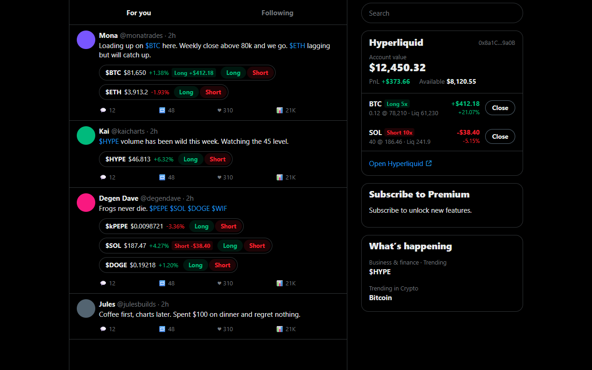
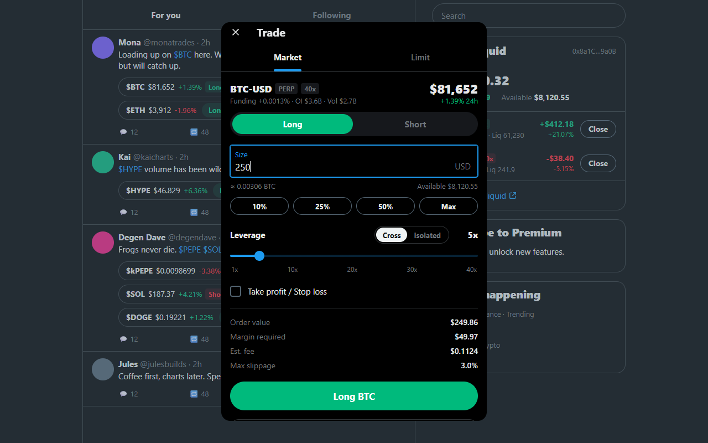

# Hypertag

**Long or short Hyperliquid perps straight from your X timeline.** Hypertag is a Chrome extension that puts a live price and **Long / Short** buttons under every `$cashtag` on x.com, in a UI that looks like X itself.

Website: [hypertag.trade](https://hypertag.trade) · License: [MIT](LICENSE)

> Unofficial. Not affiliated with X Corp. or Hyperliquid. Trading perpetuals with leverage can lose you money fast. Try it on **Testnet** first.



## Features

- **Cashtag chips on posts:** every `$BTC`, `$ETH`, `$HYPE`… listed on Hyperliquid gets the live price, its 24h change and **Long / Short** buttons. `$PEPE`, `$BONK` and similar map to `kPEPE`, `kBONK`.
- **Cashtag hover card:** hover any `$cashtag` link for an X-style card with the price, a 24h chart, funding, open interest, volume, your position and Long / Short buttons.
- **Trade button in the action bar:** next to Reply / Repost / Like on posts with cashtags. It opens a menu with one-tap market presets (Long or Short $25 / $50 / $100, tap twice to confirm) and a link to the full trade sheet.
- **Trade sheet:** Market or Limit, Long or Short, size in USD with 10/25/50%/Max, a leverage slider, Cross or Isolated margin, optional take profit / stop loss, and an order value, margin and fee preview. Your open position shows with a two-step Close.
- **Sidebar card:** account value, PnL, available margin and open positions with one-tap close, in X's right column.
- **Popup:** account overview, positions, default size / leverage / slippage, a Mainnet/Testnet switch, and toggles for the chips, sidebar card, Trade button and hover card.
- **Looks native:** follows your X display setting (Lights out, Dim or Default) and accent color.



## Install

The Chrome Web Store listing is in review. Until it's live, install from GitHub, which takes about a minute:

1. Download **`hypertag-<version>.zip`** from the [latest release](https://github.com/hypertagcoin/hypertag/releases/latest).
2. Unzip it into a folder you'll keep. Chrome loads the extension from that folder, so don't delete it.
3. Open `chrome://extensions` and turn on **Developer mode** (top right).
4. Click **Load unpacked** and select the unzipped folder (the one containing `manifest.json`).
5. Refresh any open x.com tabs. Chrome only adds extensions to pages loaded after install.

Works in Chrome 116+ and other Chromium browsers (Brave, Edge, Arc).

**Updating:** download the new release, replace the folder's contents, click ↻ on Hypertag in `chrome://extensions`, then refresh x.com. Manually installed extensions don't update automatically.

## Connect your account

Either way, Hypertag only ever holds a Hyperliquid **API wallet**: a trading-only key that can place and cancel orders but can **never withdraw or transfer funds**. Hyperliquid enforces that limit.

1. **Browser wallet (recommended).** Click **Connect** in the sidebar card or the popup. Hypertag creates a fresh key locally, and your wallet (MetaMask, Rabby, any EIP-6963 wallet) signs one `ApproveAgent` message. No gas, no transaction. The key is registered under the name `Hypertag`, so reconnecting replaces it.
2. **Import an API wallet.** Create one at [app.hyperliquid.xyz/API](https://app.hyperliquid.xyz/API) and paste its private key into the popup. Hypertag checks with Hyperliquid that the key really is an approved API wallet, and refuses main-wallet keys.

Your Hyperliquid account must have made at least one deposit before Hyperliquid accepts any action, including approving the key. Unified accounts, where spot USDC is your perps margin, are supported.

Disconnecting deletes the key from your browser. You can also revoke it at app.hyperliquid.xyz/API.

## Security model

- **The key stays in the extension.** It lives only in the extension's background worker (`chrome.storage.local`), where every order is signed. The x.com page and the on-page script never see it.
- **Keys are only typed in the popup,** never on x.com, so page scripts can't read your keystrokes. Key import, settings changes and disconnect are refused if requested from x.com.
- **Wallet bridge.** `bridge.js` runs in the page's main world because that's the only place browser wallets are reachable. It forwards just `eth_requestAccounts`, `eth_chainId` and `eth_signTypedData_v4`. The account saved after connecting is the one recovered from the signature, not whatever the page reports.
- **Injected UI** uses closed shadow roots and never uses `innerHTML`. Order buttons ignore synthetic (`!isTrusted`) clicks.
- **The key is stored without a password,** so anyone with access to your Chrome profile can trade with it (but not withdraw). Disconnect on shared machines.
- **Network:** the only network calls go to `api.hyperliquid.xyz` (and `api.hyperliquid-testnet.xyz` on Testnet). No analytics. See the [privacy policy](https://hypertag.trade/privacy).

## How orders are sent

- **Market** orders are IOC limit orders at mid ± your slippage setting (default 3%), the same approach as Hyperliquid's official SDK. **Limit** orders are GTC.
- **Leverage and margin mode:** if they differ from what's set on Hyperliquid for that coin, an `updateLeverage` is sent first.
- **TP/SL** are reduce-only trigger-market orders attached with `normalTpsl` grouping.
- **Rounding:** prices are rounded to 5 significant figures and sizes down to the coin's `szDecimals`. The minimum order is $10 of position.

## Build from source

Requires Node.js 18+.

```bash
npm install
```

```bash
npm run build
```

Then **Load unpacked** the `dist/` folder.

| Command | What it does |
|---|---|
| `npm run watch` | Rebuild `src/` on change (re-run `build` after editing `static/`) |
| `npm test` | Signing tests against vectors from the official `hyperliquid-python-sdk` |
| `npm run package` | Build and zip into `release/hypertag-<version>.zip` |
| `npm run icons` | Render `static/icons/` from `assets/hypertag-logo.webp` |
| `npm run store-assets` | Render Chrome Web Store screenshots via `dev/harness.html` (needs Chrome installed) |

**Signing is verified:** `test/vectors.json` was generated with `hyperliquid-python-sdk` 0.24.0. The tests check that the order wire format, msgpack action hash, L1 signatures (mainnet and testnet), `updateLeverage` and `approveAgent` EIP-712 signatures are byte-identical to the SDK.

**UI playground:** `dev/harness.html` and `dev/popup-harness.html` mock the `chrome.*` APIs (and a fake wallet) on X-shaped markup. Build first, serve the repo root with any static server, and open `dev/harness.html?theme=dark`. `theme` can be `light`, `dim` or `dark`; add `&connected=0` for the logged-out state.

## Releasing

1. Bump `version` in `static/manifest.json` and `package.json`.
2. Commit, then tag and push:

```bash
git tag v1.0.1
```

```bash
git push origin v1.0.1
```

The [Release workflow](.github/workflows/release.yml) runs the tests, builds the ZIP and publishes it as a GitHub Release. The same ZIP is what gets uploaded to the Chrome Web Store; listing text and privacy answers are in [store/listing.md](store/listing.md).

## Layout

```
src/lib/          shared: Hyperliquid signing + wire format, rounding, formatting, DOM helpers
src/background/   service worker: storage, API client, order logic, message router
src/content/      x.com UI: chips, trade sheet, sidebar card, connect dialog, wallet bridge
src/popup/        popup script
static/           manifest, popup HTML/CSS, icons
assets/           source logo
scripts/          build, icons, packaging, store screenshots
test/             signing tests and SDK vectors
dev/              UI playground pages with mocked chrome.* APIs
store/            Chrome Web Store listing text and images
```

## Limitations

- Main Hyperliquid perps only: no spot and no HIP-3 builder-deployed markets.
- No UI for open (resting) orders yet. Manage those on Hyperliquid.
- X changes its markup from time to time. Hypertag supports both X's classic layout (`data-testid` attributes) and its newer one (plain `<article>` posts); if chips stop appearing, please open an issue.

## Contributing

Issues and pull requests are welcome. Please run `npm test` before opening a PR, and never paste real private keys into issues.
